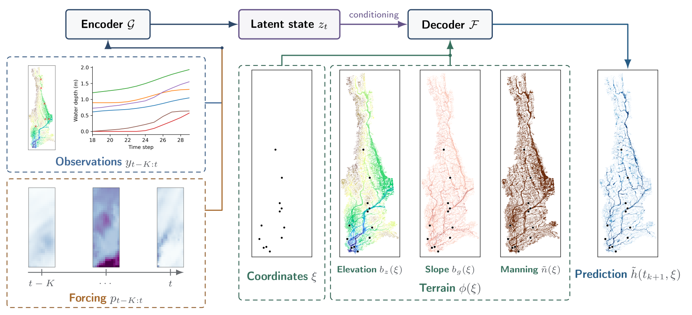
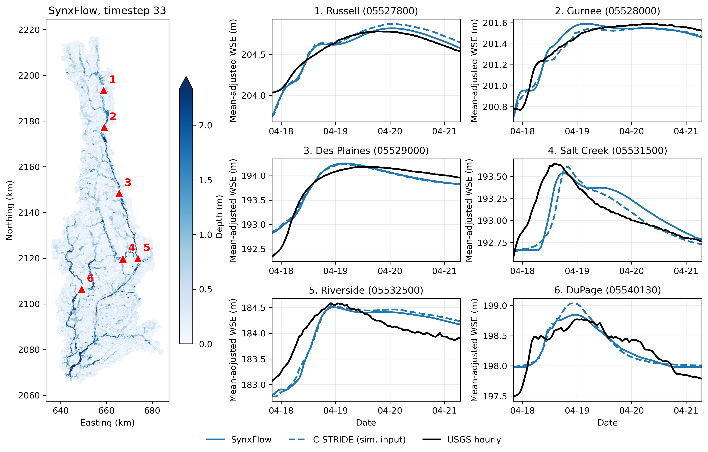

# C-STRIDE: basin-wide flood prediction from sparse gauge histories

Code, compact input data and trained models for:

> Yanjie Tong, Phillip Si, Yuan Qiu, and Peng Chen (2026). *C-STRIDE: An Observation-Driven AI Digital Twin for Predicting Basin-Wide Flood Fields from Sparse Stream-Gauge Histories.* [arXiv:2609.39005](https://arxiv.org/abs/2609.39005).

[Paper](https://arxiv.org/abs/2609.39005) · [Models](checkpoints/README.md) · [Data](data/README.md) · [Paper results](results/README.md) · [Quick start](#quick-start)

**From six stream gauges to a basin-wide flood-depth field.** C-STRIDE learns to reconstruct water depth across the Des Plaines River basin in greater Chicago from a short history of gauge observations. An LSTM encodes the histories into a shared latent state; a modulated neural-field decoder combines that state with query coordinates and optional terrain features. Rainfall provides additional temporal conditioning. For multi-step forecasts, a separate LSTM predicts the gauge trajectories, which the same field decoder turns into successive depth maps.

The full model uses **12 hourly observations at six gauges**. On the paper's four test events it achieves **10.63% mean snapshot-wise relative depth error**, compared with **18.14%** for the gauge-only Vanilla STRIDE model—about a **41% reduction**. For the April 2013 flood, it reconstructs the 84 target snapshots after the initial history at **993,797 evaluation cells in 21.99 seconds** on one NVIDIA L40S GPU. These are reported paper measurements; see [the results index](results/README.md) for metrics and timing scopes.

[](figures/fig01_architecture.pdf)

*C-STRIDE architecture (Figure 1). The encoder combines gauge observations and rainfall histories into a latent state. The decoder uses that state, query coordinates and terrain features to predict the next depth field. Click the diagram for the original PDF.*

## Validation against USGS gauges (April 2013)



*April 2013 flood (Figure 5). Left: reference inundation and six gauge locations. Right: water-surface elevations from SynxFlow (solid blue), full C-STRIDE (dashed blue) and hourly USGS observations (black). C-STRIDE receives simulated gauge histories in this comparison. Water-surface elevations are retrospectively mean-aligned as described in the paper. [Figure 6](figures/fig06_observed_inputs.png) separately shows the response to supplying measured gauge histories at inference.*

## Models and reported performance

All four next-step variants receive gauge histories. Their additional inputs and Table 5 depth errors are:

| Next-step model | Rainfall history | Terrain features | April 2013 error | Four-event mean error |
|---|---|---|---:|---:|
| C-STRIDE (full) | Yes | Yes | 8.38% | 10.63% |
| C-STRIDE (terrain) | No | Yes | 9.49% | 14.23% |
| C-STRIDE (forcing) | Yes | No | 13.59% | 15.73% |
| Vanilla STRIDE | No | No | 13.69% | 18.14% |

Errors are the mean snapshot-wise relative L2 errors over event-specific evaluation cells. The full model's four-event mean RMSE is **0.0631 m**. The thirteen released configurations also cover history lengths of 1, 4, 6 and 24 hours, four mainstem gauges, tributary dropout and three observation-noise levels. [Checkpoint details](checkpoints/README.md) list the best/final weights and training epochs.

For 24-hour forecasting with supplied reference future rainfall, full C-STRIDE has **14.48% mean relative depth error at lead 24** across 40 forecast origins. That result uses the auxiliary gauge forecaster and is distinct from the next-step averages above. [Figures 1–10](figures/README.md) show conditioning, spatial reconstruction, gauge comparisons, rainfall sensitivity and history-length effects.

## What is in this repository

| Folder | Contents |
|---|---|
| `code/cstride/` | Model definitions, data loading, training, inference and gauge forecasting |
| `configs/next_step/` | Thirteen paper model configurations |
| `checkpoints/` | Best/final model weights, available gauge forecasters, safe sensor maps and integrity hashes |
| `splits/chicago_split.json` | Original event IDs: 94 events, with 90 training and 4 test events |
| `data/gauges/` | Six-gauge hourly histories, station/cell mappings and April 2013 USGS inputs |
| `data/grids/` | Coordinates and as-trained static features for the four test events |
| `data/normalization/` | Cached training normalization for inference without the training simulations |
| `data/storms/` | Rainfall periods and recorded locations |
| `preprocessing/` | SynxFlow array conversion and rainfall-origin tools |
| `scripts/` | Prediction, evaluation, paper plotting and timing commands |
| `results/` | Selected numeric data and reported values used in the paper |
| `figures/` | The ten paper figures |

**Full simulated flow fields are not bundled.** Released compact inputs suffice for prediction on test events **107, 108, 109 and 120**; event 120 is the April 2013 flood. Rainfall is read directly from the public [CLDNet](https://github.com/Flood-Digital-Twins/CLDNet) dataset. Training and full-field scoring additionally require prepared reference simulations. Data formats and preprocessing conventions are specified in [data/README.md](data/README.md).

## Quick start

Python ≥ 3.10 with a suitable PyTorch CPU/CUDA build. CUDA is recommended for basin-wide inference; the CPU path is supported. Clone C-STRIDE and CLDNet into sibling directories:

```bash
git clone https://github.com/Flood-Digital-Twins/CSTRIDE.git
git clone https://github.com/Flood-Digital-Twins/CLDNet.git
cd CSTRIDE
python -m pip install -r requirements.txt
```

**Predict the April 2013 depth field from released gauge histories:**

```bash
python scripts/predict_cstride.py --model full --storm 120 --cldnet-root ../CLDNet --device cuda:0
```

**Supply the released USGS observation inputs instead:**

```bash
python scripts/predict_cstride.py --model full --storm 120 --cldnet-root ../CLDNet --observations usgs --device cuda:0
```

**Produce a 24-hour forecast using the rainfall-aware gauge predictor:**

```bash
python scripts/predict_cstride.py --model full --storm 120 --cldnet-root ../CLDNet --forecast --obs-rainfall --start 12 --steps 24 --device cuda:0
```

Prediction writes a peak-depth `.npz` and metadata under `outputs/predictions/`. Add `--save-fields` for per-step float32 depth arrays; `--chunk-size` bounds decoder memory. Next-step target `t` uses observations from `t-lag` through `t-1`. Forecasting inserts predicted gauges and supplied future rainfall into subsequent histories.

Vanilla and terrain-only next-step models do not require rainfall. For a small CPU example:

```bash
python scripts/predict_cstride.py --model vanilla --storm 120 --steps 1 --device cpu
```

Tracking is disabled by default and requires no account. The compact launcher uses supplied histories without injecting robustness perturbations; use the prepared-data scorer below for noise/dropout experiments. Python imports use `cstride`; the model classes are `CSTRIDE` and `CSTRIDEForecast`.

## Preparing simulation data

[Data formats](data/README.md) describe the compact gauge histories, safe sensor maps, query grids, USGS alignment and cached normalization. Full simulations are supplied separately when training or scoring. Prepare collected SynxFlow output as follows:

```bash
python preprocessing/prepare_arrays/prepare_arrays.py --input-dir data/sims_30/event_107 --traj-id 107 --output-dir data/Chicago --legacy-manning-order
```

Repeat for events needed by the split. The legacy Manning switch reproduces the feature used by released weights; omit it for corrected new training. See [preprocessing options](preprocessing/prepare_arrays/README.md). Original event IDs are retained in [the split](splits/chicago_split.json); [storm metadata](data/storms/README.md) explains rainfall periods and locations.

## Training and evaluation

The thirteen model configurations are in `configs/next_step/`; [model details](checkpoints/README.md) list checkpoints and epochs. Training uses SOAP, normalized MSE, a plateau scheduler and checkpoint-loss monitoring with early stopping.

```bash
python scripts/train_next_step.py --config configs/next_step/full.yaml --data-root data/Chicago --device cuda:0
mkdir -p outputs
cp -r checkpoints/full outputs/full
python scripts/evaluate_next_step.py --path outputs/full --data-root data/Chicago --normalizers data/normalization/normalizers.npz --device cuda:0
python scripts/forecast_observations.py --path outputs/full --data-root data/Chicago --normalizers data/normalization/normalizers.npz --horizon 24 --obs_include_precipitation_input --device cuda:0
```

Use a checkpoint copy for evaluators that append files beside it. Training normally fits normalization from the training data; `--normalizers` loads cached statistics. `--split-file` selects an explicit event-ID protocol; `--num-workers 0 --device cpu` is useful for debugging. Compilation is opt-in. Run a launcher with `--help` for its complete options.

For multi-GPU training:

```bash
torchrun --nproc_per_node=2 scripts/train_next_step.py --config configs/next_step/full.yaml --data-root data/Chicago --ddp
```

The GPU filter defaults to 40 GiB free memory. `--init-checkpoint` loads weights without optimizer/scheduler state and writes to that checkpoint's run directory, so use a working copy. Direct autoregressive and latent forecasts are extra model workflows; the paper forecast uses the gauge forecaster.

## Paper results and figures

[Results](results/README.md) maps paper tables to numeric files; [figures](figures/README.md) lists Figures 1–10. New evaluations write under `outputs/` and remain separate from reported paper values.

```bash
python release/rescore_checkpoints.py --data-root data/Chicago --device cuda:0
python scripts/generate_paper_results.py --data-root data/Chicago --device cuda:0
python scripts/plot_paper_results.py
python scripts/compute_persistence.py --data-root data/Chicago
python scripts/plot_chicago_future_precipitation.py --persistence results/persistence.json
python scripts/plot_chicago_precipitation_mismatch.py
python scripts/time_inference.py --cldnet-root ../CLDNet --device cuda:0
```

The generator writes prediction products to `outputs/paper/`, which the plotting script reads. The rainfall plots can use the bundled paper summaries without full simulations. Supply `--data-root` to recompute rainfall mismatch statistics. Re-scoring applies each model's configured noise/dropout and records an explicit seed. Noise scores may vary with the seed. Add `--forecast-data-root data/Chicago` to the timing command to measure the complete 40-by-24-step forecast experiment; its timing includes preparation/scoring, whereas next-step timing excludes scoring.

For public CLDNet predictions, run its `predict_cldnet.py --save-fields`, then adapt each output and score it against matching prepared truth:

```bash
python scripts/adapt_cldnet_predictions.py --input ../CLDNet/outputs/predictions/cldnet_107.npz --grid ../CLDNet/data/illinois_grid/grid.npz --output outputs/cldnet_predictions/predictions_traj107.npz
python scripts/score_cldnet_baselines.py --prediction_dir outputs/cldnet_predictions --data_root data/Chicago --source_dense_roots data/sims_30 --valid_mask_mode dense_flow --trajectory_ids 107 108 109 120 --output outputs/cldnet_scores.txt
```

Use the actual CLDNet output filename and repeat conversion for all four test events. Zero-filled cells outside CLDNet's aggregate mask are not model predictions; the event-120 grid differs by two cells, so converted predictions need not reproduce the reported baseline exactly. Bundled baseline values are transcribed from Tables 5 and 8; the CLDNet comparison uses its epoch-539 checkpoint.

## Revision (November 2026)

[revision/](revision/README.md) holds the scripts, tables, figures and retrained models behind the revised results: the USGS comparison on the corrected clock and at the CLDNet cross-sections, the fixed-grid evaluation of Tables 5 and 8, the independent-gauge check, and the retrained models E5 (corrected Manning) and E8 (fixed grid, clean split). The released files outside that folder are unchanged, so the submission numbers still reproduce. Points documented there:

- The USGS stage files are in CST (UTC-6). Simulation frame *i* (2013-04-17 08:00 UTC + *i* h) pairs with CSV time 02:00 + *i*; the submission paired it with 08:00 + *i*. `data/gauges/usgs_2013/usgs_observations.npz` keeps the submission pairing; the CST series is `revision/results/e1e2/usgs_observations_CST_full.npz`.
- The released models chose `best_model.ckpt` and stopped early on `checkpoint_monitor_files` (storms 107-116), which include the test storms 107, 108 and 109.
- `train_files` lists 100 storms; 85-89 and 95-99 repeat the rainfall of 25-29 and 35-39, so the released models saw 90 distinct storms. E8 trains on the 90 distinct storms and selects no checkpoint on test storms.

## Tests and integrity checks

```bash
python -m pip install -e '.[dev]'
python -m pytest -q
python release/verify_release.py --checksums
sha256sum -c data/SHA256SUMS
```

Tests cover released weights, gauge forecasters, temporal alignment, normalization, decoder chunking, event-ID loading, publication assets and synthetic training/evaluation. Full training convergence, multi-GPU training and compilation are outside this verification. Checkpoint and compact-input hashes are recorded in their manifests.

## Input conventions and limitations

The released models preserve **float16 coordinates** and the **as-trained Manning feature** for checkpoint compatibility. The Manning channel has the historical row-registration error also documented by CLDNet. Use the as-trained feature with released weights; use corrected registration for new training. [Array preparation](preprocessing/prepare_arrays/README.md) explains the corresponding options.

The numbered rainfall fields were recorded outside the basin and applied as forcing; the 2013 event occurred on the basin. USGS inputs use retrospective mean alignment. Forecast results assume supplied future rainfall. Noise scores depend on the random seed, and timing comparisons must retain the scopes stated in the paper.

## License

Original code and trained models: [MIT](LICENSE). Released input data: [CC BY 4.0](data/LICENSE.md). Third-party component notices and licenses are retained in [THIRD_PARTY_NOTICES.md](THIRD_PARTY_NOTICES.md).

## Citation

```bibtex
@misc{tong2026cstride,
  title         = {{C-STRIDE}: An Observation-Driven {AI} Digital Twin for Predicting Basin-Wide Flood Fields from Sparse Stream-Gauge Histories},
  author        = {Tong, Yanjie and Si, Phillip and Qiu, Yuan and Chen, Peng},
  year          = {2026},
  eprint        = {2609.39005},
  archivePrefix = {arXiv},
  url           = {https://arxiv.org/abs/2609.39005}
}
```
